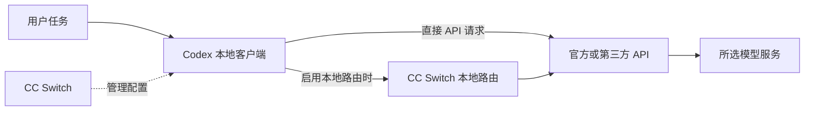

# OpenAI Setup Guide

**中文入门指南：使用 CC Switch 配置 Codex，从安装、接入到验证与排错。**

想在电脑上使用 Codex，却不清楚 API Key 在哪里填写、如何选择中转服务、切换后为什么不生效？这份教程把整个流程串起来，帮助你完成第一次接入，也方便后续切换服务商。

本教程以 **Windows + PowerShell + Codex CLI** 为主线，补充 macOS / Linux、WSL、IDE 和桌面客户端的注意事项。你可以使用 OpenAI 官方服务，也可以根据接口兼容性选择第三方服务。

> 本项目是社区整理的操作指南，与 OpenAI、CC Switch 或第三方服务商无隶属关系。软件界面、登录方式和配置字段会随版本变化，请以对应版本的官方说明为准。

## 目录

- [你需要准备什么](#preparation)
- [先理解几个关键概念](#concepts)
- [选择接入方式与服务商](#provider)
- [安装 Codex 与 CC Switch](#installation)
- [配置与切换服务商](#configuration)
- [验证是否配置成功](#verification)
- [进阶：理解 API 与手动配置](#advanced)
- [常见问题与排错](#troubleshooting)
- [恢复官方登录](#restore)
- [密钥、隐私与费用管理](#security)
- [把项目上传到 GitHub](#publishing)
- [参考资料与适用范围](#references)

<a id="preparation"></a>

## 你需要准备什么

| 准备项 | 用途 | 是否必需 |
| --- | --- | --- |
| 可联网的电脑 | 安装工具、连接模型服务 | 必需 |
| Codex CLI | 在终端中理解代码、修改文件和执行任务 | 本教程主线需要 |
| CC Switch | 管理和切换服务商配置 | 跟随本教程配置流程需要 |
| Node.js 与 npm | 通过 npm 安装 Codex CLI | 使用 npm 安装方式时需要 |
| 账号或 API 凭据 | 登录或调用模型服务 | 按接入方式准备 |
| 测试目录 | 验证接入，避免影响现有项目 | 建议准备 |
| Git 或 GitHub Desktop | 保存修改、上传仓库 | 发布项目时使用 |

**使用 Codex CLI 不要求先安装 ChatGPT 桌面客户端。** ChatGPT 网页可以直接在浏览器中打开，CLI 和桌面客户端则是不同的产品入口，需要按各自说明安装。

如果已经安装了 Codex 和 CC Switch，可以直接跳到[配置服务商](#configuration)。

<a id="concepts"></a>

## 先理解几个关键概念

| 名称 | 是什么 | 容易混淆的地方 |
| --- | --- | --- |
| ChatGPT | 用于对话、研究和其他任务的产品 | 网页登录不等于取得 API Key |
| Codex | 面向项目和代码任务的工具 | 有 CLI、IDE、桌面和云端等不同入口 |
| CC Switch | 管理客户端配置的工具 | 本身不提供模型额度，也不替代 Codex |
| API Key | API 请求的访问凭据 | 必须与签发它的服务商、项目和权限对应 |
| Base URL | API 服务的基础地址 | 通常不是网站首页，也不是完整请求端点 |
| 模型 ID | 请求中使用的模型标识 | 不一定等于网页上的展示名称 |
| 中转服务 | 通过第三方地址转发或提供模型请求 | 接口、费用和数据处理方式由该服务商决定 |
| Responses API | OpenAI 的一种模型请求接口 | 与 Chat Completions 不是同一套请求格式 |

### 整个流程是怎样连接起来的？



普通配置切换主要是让 Codex 使用所选服务商的配置。启用本地路由后，请求会先经过 CC Switch，再转发给上游；此时需保证路由进程运行。

<a id="provider"></a>

## 选择接入方式与服务商

### 三种常见方式

| 方式 | 需要准备 | 适合的需求 |
| --- | --- | --- |
| ChatGPT 登录 | 可使用 Codex 的账号及相应权益 | 使用订阅所支持的 Codex 功能 |
| OpenAI 官方 API | OpenAI Platform 的 API Key、模型权限和可用额度 | 直接使用官方 API，按 API 规则计费 |
| 第三方 API / 中转 | 对应服务商的 Key、Base URL、模型 ID 和兼容说明 | 使用自选服务商，或管理多个接口 |

**通过 API Key 使用 API，按相应 API 账户计费，不会自动使用 ChatGPT 订阅中的额度。** 账号是否能用某个模型、客户端或功能，还要看当前权益与访问权限。官方说明见[认证文档](https://learn.chatgpt.com/docs/auth)。

本教程后面的操作主要说明 API / 中转配置；如果选择 ChatGPT 登录，可以按客户端登录流程操作，不需要额外购买中转服务。

### Codex 只能接入 OpenAI 官方 API 吗？

不是。Codex 本地客户端支持自定义模型服务商，见[官方高级配置文档](https://learn.chatgpt.com/docs/config-file/config-advanced)。但“OpenAI 兼容”不代表所有功能都兼容。

- 本教程的直接接入示例采用 **Responses API**，需要服务商支持相应请求、流式响应和工具调用。
- 只提供 `/v1/chat/completions`，不能据此断定本教程的 Responses 配置可以工作。
- CC Switch 的部分版本提供本地路由与协议转换；使用转换时需核对版本、上游格式和功能支持。
- 某个模型能正常聊天，也不代表它能完整执行 Codex 的代码任务。

### 怎样选择中转服务？

优先确认这些实际信息：

| 检查项 | 应该确认的内容 |
| --- | --- |
| Codex 支持 | 是否有明确的 Codex 接入说明，而不只是普通聊天示例 |
| 接口格式 | 支持 Responses、Chat Completions 还是其他格式 |
| 模型权限 | 账号能使用的模型 ID，是否存在单独权限或分组限制 |
| 费用与限额 | 输入、输出、缓存、工具等计费方式，余额和并发限制 |
| 数据处理 | 请求会经过哪些服务，是否保存提示词、代码和日志 |
| 排错支持 | 是否提供请求记录、错误正文和问题处理渠道 |

原项目提到的 [Deponia](https://www.deponia.me/) 保留为第三方服务示例。本教程没有验证它当前的运营状态、价格、数据政策或 Codex 兼容性，也不要求必须选择它。注册和使用前，请查阅所选服务商自己的接入说明。

<a id="installation"></a>

## 安装 Codex 与 CC Switch

### 第一步：检查 Node.js 与 npm

打开 PowerShell，运行：

```powershell
node --version
npm --version
```

如果命令不存在，从 [Node.js 官网](https://nodejs.org/)安装当前维护的 LTS 版本，并确认满足 Codex 安装包的运行要求。安装后重新打开终端，再检查版本。

### 第二步：安装 Codex CLI

```powershell
npm install -g @openai/codex
codex --version
```

能输出 Codex 版本，说明命令可以启动；这一步还没有验证 API、密钥或模型。Codex 的其他安装方式和当前更新说明见[官方 CLI 文档](https://learn.chatgpt.com/docs/codex/cli)。

升级时也可以使用相同的 npm 安装命令。已有可用环境时，先记录版本并备份配置，再升级。

如果 PowerShell 提示 `npm.ps1` 或 `codex.ps1` 被执行策略阻止，可以先尝试命令包装文件：

```powershell
npm.cmd --version
npm.cmd install -g @openai/codex
codex.cmd --version
```

也可在命令提示符中运行安装命令。受管理的电脑应遵循组织的执行策略，不需要为本教程关闭整台电脑的安全限制。

### 第三步：安装 CC Switch

下载入口：[CC Switch 官网](https://ccswitch.io/zh/) / [GitHub Releases](https://github.com/farion1231/cc-switch/releases)。

1. 选择与操作系统、CPU 架构匹配的安装包。
2. 按发布说明完成安装并打开 CC Switch。
3. 找到 **Codex** 页面或应用管理入口。
4. 确认管理的是实际运行 Codex 的配置目录。
5. 在首次添加服务商前，备份已有配置和登录状态。

菜单名称可能随版本变化。不要把 Claude Code 或其他工具页面中的配置，当成 Codex 配置。

### macOS / Linux

具备 Node.js 与 npm 后，也可以使用 npm 安装方式：

```bash
node --version
npm --version
npm install -g @openai/codex
codex --version
```

遇到全局安装目录权限问题时，优先使用符合个人环境的 Node.js 版本管理方案。CC Switch 安装包则按其 Releases 的系统要求选择。

### Windows 与 WSL 的区别

Windows 原生终端与 WSL 是两个不同环境，各自的 Codex、环境变量和配置目录可能不同。

| 运行方式 | 默认用户配置文件 |
| --- | --- |
| Windows 原生 | `C:\Users\<用户名>\.codex\config.toml` |
| macOS / Linux / WSL | `~/.codex/config.toml` |

设置了 `CODEX_HOME` 时，配置位置可能改变。先确认实际目录，再让 CC Switch 管理同一个目录。

如果在 WSL 中运行 Codex、在 Windows 中运行 CC Switch，需要按其手册指定 WSL 配置目录。使用本地路由时，还需确认 WSL 能连接 Windows 的路由端口；WSL2 默认 NAT 下的 `127.0.0.1` 不能简单视为 Windows 主机地址。

<a id="configuration"></a>

## 配置与切换服务商

### 第一步：创建 API Key

在所选服务商控制台创建专用于 Codex 的密钥，确认它有目标模型和接口的访问权限。记录服务商提供的接入信息，不要把真实 Key 写进本教程。

| 字段 | 示例，仅作格式说明 | 填写要点 |
| --- | --- | --- |
| 服务商名称 | `我的 Codex 服务商` | 使用便于区分的名称 |
| Base URL | `https://api.example.com/v1` | 使用服务商给出的 API 基础地址 |
| API Key | 在本机私下填写 | 与当前服务商对应，避免空格和换行 |
| 模型 ID | `<服务商提供的模型ID>` | 使用实际请求标识，并确认权限 |
| 接口格式 | `Responses API` | 本教程的直接接入路径采用此格式 |

`example.com` 和尖括号中的内容都是占位符，不能原样用于真实请求。

**Base URL 不一定包含 `/v1`。** 不要自行添加、删除或重复路径；不要把网站首页、控制台页面或完整 `/responses` 端点当作基础地址。应按服务商的具体说明填写。

### 第二步：手动添加服务商

1. 在 CC Switch 中选择 **Codex**。
2. 点击添加服务商，选择匹配的预设或自定义配置。
3. 填入名称、Base URL、密钥、模型 ID 和接口格式。
4. 检查预设中的默认值，不要假定预设一定适合当前账号。
5. 保存后切换到该项，确认显示为当前启用的服务商。
6. 退出并重新启动 Codex，再执行一次小任务验证。

已有配置时，不要整份覆盖 `config.toml`。其中可能还包含 MCP、权限、项目和其他设置。

### 另一种方式：通过网站导入

部分服务商在创建 Key 后提供“导入 CC Switch”按钮或 `ccswitch://` 链接：

1. 确认正在访问自己选择的服务商网站。
2. 点击导入，按浏览器提示打开 CC Switch。
3. 在导入预览中核对工具类型、名称、地址、模型与接口格式。
4. 确认后保存，并在 Codex 页面切换到该项。
5. 重启客户端，执行一次真实请求。

浏览器没有反应时，先确认 CC Switch 已安装、浏览器允许打开应用，再尝试手动添加。**导入链接可能包含密钥，不要公开分享完整链接。**

### 直接接入与本地路由

| 模式 | 请求路径 | 使用条件 |
| --- | --- | --- |
| 直接接入 | Codex → 服务商 API | 客户端与上游接口直接兼容 |
| 本地路由 | Codex → CC Switch → 服务商 API | 路由运行，上游格式正确，本地端口可访问 |

路由模式下，Codex 配置中的地址可能变成 `127.0.0.1`，密钥可能显示为占位值，真实上游信息由 CC Switch 管理。此时不要擅自把本地地址改成上游地址。

只提供 Chat Completions 或其他协议的服务，要先核对当前 CC Switch 版本是否有适用的转换路径，不能直接套用本教程的 Responses 模板。首次配置建议先验证单一服务商，再增加路由、转换或聚合功能。

### 切换后为什么要重启？

客户端可能只在启动时读取部分配置。普通切换后按提示重新启动 Codex；IDE 场景可能需要重新打开编辑器窗口，桌面场景可能需要完全退出后重开。

如果改变了环境变量，也要从能读取新变量的环境启动客户端。聚合模式或模型列表变化还可能需要重启 Codex 后台进程；先保存正在运行的任务，再按 CC Switch 的提示处理。

<a id="verification"></a>

## 验证是否配置成功

### 1. 建立测试目录

在一个适合练习的位置打开 PowerShell：

```powershell
New-Item -ItemType Directory -Force -Path .\codex-demo | Out-Null
Set-Location .\codex-demo
codex
```

首次运行时确认当前目录和信任提示。先用不含敏感资料的目录测试，再进入正式项目。

### 2. 验证文本请求

发送：

```text
请用中文回复“连接成功”，然后说明你当前可以使用哪些工具。暂时不要修改文件或执行命令。
```

能返回正常回答，说明这次模型请求成功。但“连接成功”只是提示词要求的文字，不能证明实际模型身份。

### 3. 验证文件任务

继续发送：

```text
请在当前目录创建 hello.txt，只写入一行 Hello, Codex!，然后读取文件确认内容。
```

根据客户端显示的操作决定是否批准。任务结束后，在该目录的终端检查：

```powershell
Get-Content -LiteralPath .\hello.txt
```

如果只返回文字而没有创建文件，检查是否等待权限、工具调用报错，或当前工作目录不一致。接口兼容性不足也可能导致工具任务失败。

### 4. 检查用量并记录结果

在服务商后台核对测试时间、请求记录和用量。首次配置成功后，可在本机记下：

```text
验证日期与时区：
操作系统 / 是否使用 WSL：
Codex 版本：
CC Switch 版本：
接入方式与请求模式：
模型 ID：
文本请求结果：
文件任务结果：
用量是否相符：
脱敏错误信息（如有）：
```

CC Switch 的“检测连通”不能代替真实模型请求，也不能单独证明 Key、模型和工具功能都可用。

<a id="advanced"></a>

## 进阶：理解 API 与手动配置

已经通过 CC Switch 成功接入时，可以跳过本节。这里用于理解字段，或判断问题是否来自上游接口。

### 用户级配置示例

下面是自定义服务商的 TOML 示例，**不是可以直接使用的真实配置**：

```toml
model = "REPLACE_WITH_PROVIDER_MODEL_ID"
model_provider = "relay_example"

[model_providers.relay_example]
name = "My API provider"
base_url = "https://api.example.com/v1"
env_key = "RELAY_API_KEY"
wire_api = "responses"
```

- `model`：替换成账号可用的模型 ID。
- `model_provider`：与下面表名中的 `relay_example` 一致。
- `base_url`：替换成实际 API 基础地址。
- `env_key`：环境变量名称，**不是密钥本身**。
- `wire_api`：本示例使用 Responses 接口。

备份后，仅把必要字段合并到实际的**用户级** `config.toml`。当前官方文档说明，项目级配置不能覆盖部分服务商和认证字段；不要把这段当作项目配置直接放入仓库的 `.codex/config.toml`。见[高级配置文档](https://learn.chatgpt.com/docs/config-file/config-advanced)。

### 在当前终端设置临时密钥

仅当采用上面的 `env_key` 手动方案时，才需要以下步骤。CC Switch 保存 Key 的方案可能不同，不必同时配置两套认证。

```powershell
$secret = Read-Host '输入该服务商的 API Key' -AsSecureString
$credential = [System.Net.NetworkCredential]::new('', $secret)
$env:RELAY_API_KEY = $credential.Password
Remove-Variable secret,credential -ErrorAction SilentlyContinue
codex
```

退出 Codex 后，清理当前窗口变量：

```powershell
Remove-Item Env:RELAY_API_KEY -ErrorAction SilentlyContinue
```

此变量只影响当前终端和从它启动的子进程，不会自动传给已打开的桌面应用，也不会随终端关闭持久保存。运行中的进程仍可能保留原值，清理时先退出相关进程。环境变量不是加密保险箱，不应打印或分享。

### 独立验证 Responses API（可选）

**以下操作会发起真实 API 请求，可能产生费用。** 先确认价格、余额与模型权限。它直接请求填写的服务商地址，不读取 Codex 配置，也不经过 CC Switch 本地路由。

在专用 PowerShell 窗口中，替换地址和模型占位符后运行；密钥通过隐藏输入提供，避免直接写入命令历史：

```powershell
$apiBase = 'https://api.example.com/v1'
$modelId = 'REPLACE_WITH_PROVIDER_MODEL_ID'
$secret = Read-Host '输入该服务商的 API Key' -AsSecureString
$credential = [System.Net.NetworkCredential]::new('', $secret)
$headers = @{ Authorization = 'Bearer ' + $credential.Password }
$payload = @{
    model = $modelId
    input = 'Reply with OK.'
    max_output_tokens = 128
} | ConvertTo-Json

try {
    $result = Invoke-RestMethod `
        -Method Post `
        -Uri ($apiBase.TrimEnd('/') + '/responses') `
        -Headers $headers `
        -ContentType 'application/json' `
        -Body $payload `
        -TimeoutSec 60

    $result.output | ConvertTo-Json -Depth 20
} catch {
    if ($_.Exception.Response) {
        Write-Host ('HTTP 状态: ' + [int]$_.Exception.Response.StatusCode)
    }
    Write-Host $_.Exception.Message
    if ($_.ErrorDetails.Message) {
        Write-Host $_.ErrorDetails.Message
    }
} finally {
    Remove-Variable secret,credential,headers,payload -ErrorAction SilentlyContinue
}
```

输出限制可以缩小响应，但不是费用上限保证；推理模型在限制较小时也可能没有可见文本。遇到空输出时检查响应和模型要求，不要立即判断为密钥失效。分享报错前，删除服务商可能回显的敏感信息。

独立请求成功，只说明这次直接 Responses 请求可用。Codex 还需要流式输出、工具调用和多轮交互正常。如果独立请求成功而 Codex 失败，优先比较两者的地址、模型、接口和认证方式。

<a id="troubleshooting"></a>

## 常见问题与排错

### 先按这个顺序检查

**客户端安装 → 实际配置目录 → 当前服务商 → 地址和接口 → Key → 模型权限 → 额度与网络。**

一次只改一个字段，保留脱敏错误正文。不要只看到失败就反复换密钥、重装软件。

| 现象 | 可能原因 | 处理方法 |
| --- | --- | --- |
| 找不到 `codex` | 未安装、PATH 未生效、旧终端未重开 | 检查安装输出、命令路径并重开终端 |
| PowerShell 禁止执行脚本 | 命令调用到 `.ps1` 包装脚本 | 尝试 `npm.cmd` / `codex.cmd`，遵循组织策略 |
| 401 / 鉴权失败 | Key 错误、已撤销、服务商不匹配 | 核对签发平台、权限与复制内容 |
| 403 / 无权访问 | 账号、项目、网络来源或服务限制 | 根据错误正文检查权限和服务商规则 |
| 404 / 接口不存在 | 地址或路径错误，接口不支持 | 核对 Base URL、重复路径与 Responses 支持 |
| 400 / 请求参数错误 | 模型或接口不支持某个参数 | 检查错误字段、接口文档与模型要求 |
| 模型不存在 | ID 错误、无权限、服务商已切换 | 使用当前服务商给出的准确模型 ID |
| 429 / 请求受限 | 速率、额度、预算或其他限额 | 阅读错误正文区分原因，避免无效重试 |
| 500 / 503 | 上游错误或暂时过载 | 按服务商提示有限重试，检查服务状态 |
| 连接拒绝 / 超时 | 网络、代理、路由进程或端口问题 | 检查实际请求地址及路由运行情况 |
| 文本成功，工具任务失败 | 权限等待、接口或模型能力不足 | 检查工具错误、权限提示和兼容说明 |
| 切换后仍是旧配置 | 未重启、目录不同、其他配置覆盖 | 重启并核对实际配置与当前模型 |

第三方服务的错误语义可能不同，请优先阅读它返回的正文。官方 API 错误说明见[错误码文档](https://developers.openai.com/api/docs/guides/error-codes)。

### 安装后仍找不到 Codex

```powershell
Get-Command node,npm,codex -ErrorAction SilentlyContinue
where.exe codex
npm config get prefix
```

确认 npm 的全局可执行文件目录在 PATH 中，没有同时调用另一个旧安装。如果 `npm` 受到脚本策略限制，可换成 `npm.cmd`。

### 404：最容易检查错的是路径

例如服务商给出的基础地址已经包含 `/v1`，再次添加可能得到 `/v1/v1/responses`。填写完整端点又可能得到 `/responses/responses`。也可能地址正确，但服务商根本没有 Responses 接口。不要靠不断尝试不同斜杠来代替接入文档。

### 429：不要把所有限制都当作限速

如果是速率限制，减少并发并按 `Retry-After` 等提示等待；如果是余额、预算或使用上限，重试不会恢复访问，需要先在对应平台处理额度问题。

### 切换服务商后没有变化

确认切换的是 **Codex** 页面，再核对 Windows / WSL、用户目录和 `CODEX_HOME`。用户配置、项目配置、命令行参数及管理策略可能影响最终行为，详见[配置优先级说明](https://learn.chatgpt.com/docs/config-file/config-basic)。

如果涉及聚合模型列表，按 CC Switch 的提示保存任务并重启相应后台进程。不要直接结束所有终端进程来排错。

### 连接超时或证书报错

先检查实际 API 主机是否可达、代理是否适用于当前终端、CC Switch 路由是否运行。HTTPS 443 服务可以辅助检查端口：

```powershell
Test-NetConnection -ComputerName api.example.com -Port 443
```

先替换为实际 API 主机；本地路由应检查实际本地端口。这只验证 TCP 连接，不验证 TLS、Key 或模型。证书问题应核对系统时间、证书链与组织代理配置，不要直接关闭 TLS 校验。

### ChatGPT 登录状态正常，为何第三方请求失败？

官方登录状态与第三方 API 凭据不是同一件事。`codex login status` 可以帮助查看官方认证缓存，但不能单独证明自定义服务商的地址和认证已正确生效；还需检查有效配置及服务商请求记录。

<a id="restore"></a>

## 恢复官方登录

1. 保存当前任务，记录正在使用的第三方配置。
2. 如果启用了本地路由，按 CC Switch 的模式说明退出路由，或确认当前版本的官方登录支持情况。
3. 在 Codex 页面选择官方预设，通常名为 **OpenAI Official**；不存在时从预设重新添加。
4. 切换后退出并重新启动 Codex。
5. 使用 ChatGPT 登录时运行 `codex login`，完成浏览器登录；使用官方 API 时按官方认证流程操作。
6. 检查当前模型、认证方式和一次测试结果。

自定义 `model_provider` 或相关命令行覆盖仍在生效时，仅执行登录命令并不一定切回官方。先恢复正确的服务商配置，再验证。

<a id="security"></a>

## 密钥、隐私与费用管理

### 哪些内容不应上传到 GitHub？

- 真实 API Key、Cookie、登录令牌和 `Authorization` 请求头。
- 含密钥的 `ccswitch://` 导入链接。
- Codex 的 `auth.json`、CC Switch 数据库、完整导出与配置备份。
- 包含凭据的 `.env`、日志、终端截图与私人代码。

公开示例使用占位符。`.gitignore` 只能影响未跟踪文件，不能清除已经提交的凭据；忽略文件也不能代替提交前检查。

如果密钥已经出现在公开仓库、截图或聊天记录中，先在签发平台撤销并重新生成，再处理公开内容和 Git 历史。只删除当前文件不能让旧密钥重新安全。

### 中转服务会接触哪些数据？

API 中转会处理经过它的请求；提示词、代码片段和其他发送内容可能进入其系统。使用前查看数据保存、日志和访问政策，敏感项目还应遵循所属组织的要求。

本地路由不等于模型在本机运行，也不意味着请求不会发送给第三方。

### 如何控制测试成本？

先用一次短文本和一个小文件任务验证，再扩大上下文和任务范围。每次更换模型、服务商或路由后核对用量，避免在鉴权、额度或路径错误时无限重试。

在服务商支持的情况下，为专用 Key 设置权限、限额和用量提醒；预算提醒不一定是硬性停止额度，应确认平台的实际规则。不要根据固定价格表或“免费”宣传推断当前费用。

<a id="publishing"></a>

## 把项目上传到 GitHub

本项目以 `README.md` 为主要成果，上传后 GitHub 会直接显示教程正文、表格、代码块和 Mermaid 流程图。

### 方式一：GitHub Desktop

适合已经在本机有项目文件夹的用户：

1. 打开 GitHub Desktop，选择 **File → Add local repository**，添加本项目。
2. 在 Changes 中检查改动，确认提交内容不含凭据或私人配置。
3. 填写提交说明，例如 `docs: expand Codex and CC Switch setup guide`。
4. 点击 **Commit** 保存修改。
5. 尚未发布时选择 **Publish repository**，填写名称 `openAI-setup-guide`。
6. 选择公开或私有；需要让所有人阅读时选择公开，再发布。
7. 已发布的仓库使用 **Push origin** 上传后续提交。

公开发布前检查 README 中的链接、表格和代码示例；上传不会替你验证真实 API 兼容性。

### 方式二：Git 命令行

以下命令在**本项目目录**运行，适用于尚未关联远程仓库的情况。先在 GitHub 创建空仓库，不预先生成 README，避免引入另一套初始提交。

检查并提交 README：

```powershell
git status
git diff -- README.md
git add README.md
git diff --cached
git commit -m "docs: expand Codex and CC Switch setup guide"
```

检查当前分支与远程：

```powershell
git branch --show-current
git remote -v
```

只有在 `origin` 不存在时，才执行下面的添加命令，并替换账号占位符：

```powershell
git remote add origin https://github.com/YOUR_GITHUB_USERNAME/openAI-setup-guide.git
```

如果 `origin` 已存在，先确认它指向你的目标仓库，不要重复添加。将下面的 `YOUR_CURRENT_BRANCH` 替换为刚才查询到的分支名，再推送：

```powershell
git push -u origin YOUR_CURRENT_BRANCH
```

推送需要 GitHub 的有效认证。出现 `rejected` 时先检查远程是否已有提交，拉取并处理差异后再推送，不要直接使用强制推送覆盖远程内容。

### 方式三：网页上传

不使用 Git 时，可以在自己的 GitHub 仓库选择 **Add file → Upload files**，上传 `README.md` 并提交。若使用本项目的 ZIP，先解压后上传文件，单独上传 ZIP 不会让 GitHub 自动展示其中的 README。

<a id="references"></a>

## 参考资料与适用范围

参考资料核对日期：**2026-10-14**。

- [OpenAI / Codex 认证与登录方式](https://learn.chatgpt.com/docs/auth)
- [Codex CLI 安装与使用](https://learn.chatgpt.com/docs/codex/cli)
- [Codex 基础配置与优先级](https://learn.chatgpt.com/docs/config-file/config-basic)
- [Codex 高级配置与自定义服务商](https://learn.chatgpt.com/docs/config-file/config-advanced)
- [OpenAI API 快速开始](https://developers.openai.com/api/docs/quickstart)
- [OpenAI API 错误码](https://developers.openai.com/api/docs/guides/error-codes)
- [CC Switch 官网](https://ccswitch.io/zh/)
- [CC Switch 项目中文说明](https://github.com/farion1231/cc-switch/blob/main/README_ZH.md)
- [CC Switch 中文用户手册](https://github.com/farion1231/cc-switch/blob/main/docs/user-manual/zh/README.md)

本次整理核对了官方认证、CLI、基础/高级配置、API 快速开始和错误码文档，以及 CC Switch 项目说明。文中的命令与配置为教学示例；未使用真实密钥执行付费 API、第三方服务商或桌面操作的端到端测试，不代表任何服务商已通过兼容性认证。
